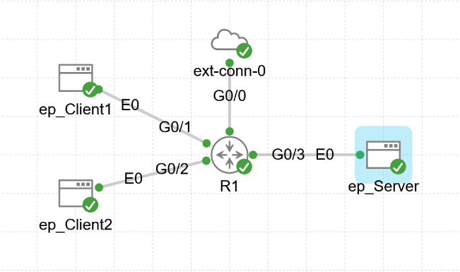
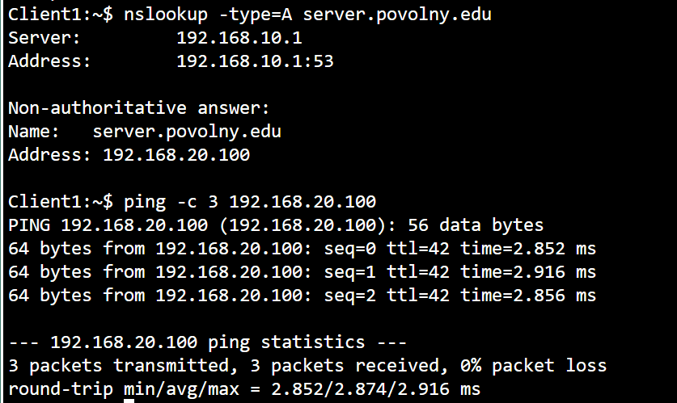
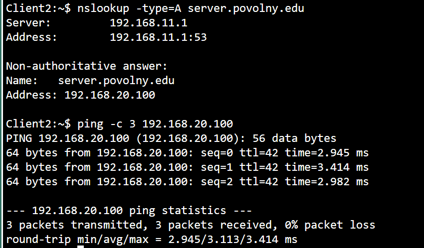
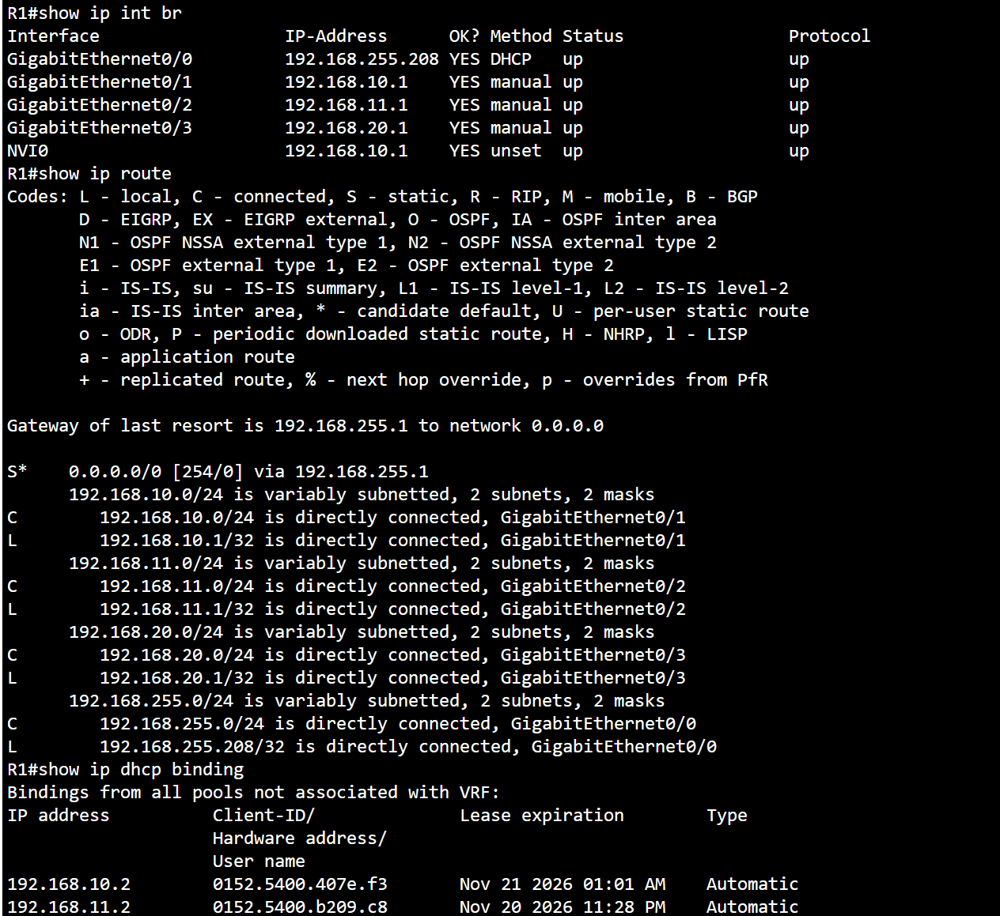
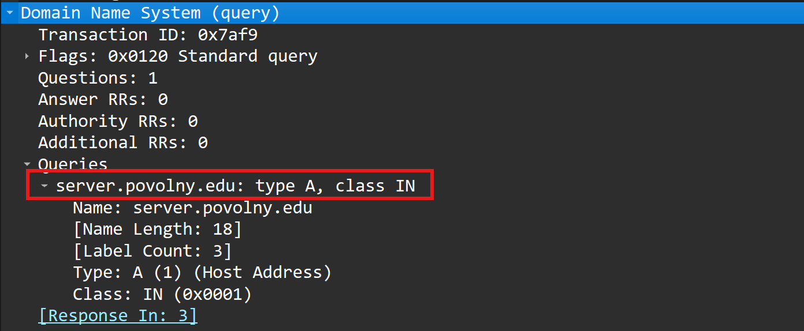
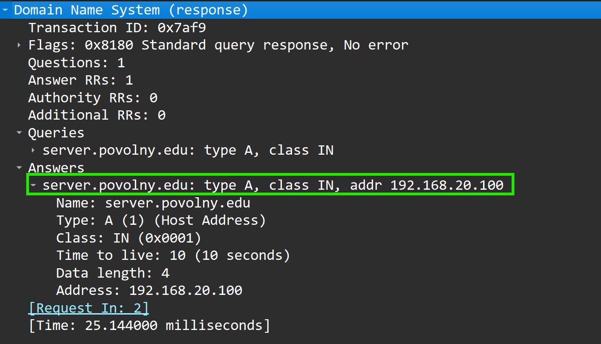

# Sprint 4: CML architecture verification

**Student Name:** Eli Povolny 
**Date:** 2026/9/16
**Course:** CS 457 - Computer Networks  
**Target Server Domain:** `server.povolny.edu`  

### Environment verification:

*Figure 1: CML topology screenshot showing alpine linux nodes ep_Client1 and ep_Client2 connected to ep_Server via router R1*

*Figure 2: Client 1 ping and nslookup output*

*Figure 3: Client 2 ping and nslookup output*

*Figure 4: Router show ip int br, show ip route, and show ip dhcp binding output*

*Figure 5: Wireshark screenshot of captured DNS request for the A record for server.povolny.edu*

*Figure 5: Wireshark screenshot of captured DNS response containing the A record for server.povolny.edu*